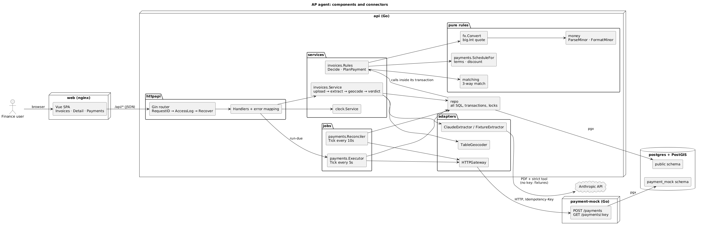
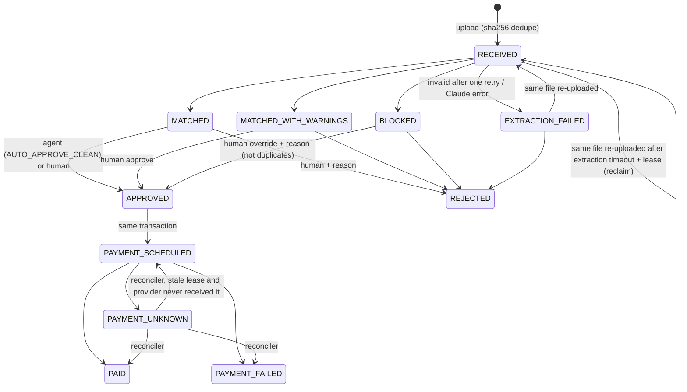
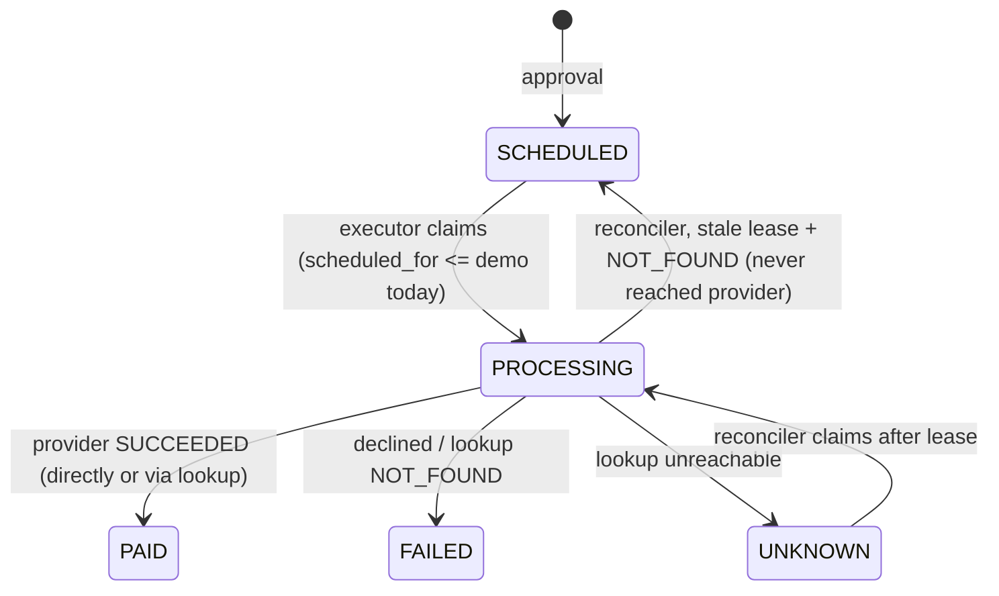

# AP Agent: cross-border supplier invoices

A demo accounts-payable agent for a LatAm business that pays international suppliers. A finance user uploads a supplier invoice (PDF, English or Spanish). The agent:

1. **Reads it with Claude.** It extracts structured data, with every amount copied as printed.
2. **Runs a 3-way match.** It compares the invoice against the purchase order and the goods receipts in plain, deterministic Go.
3. **Flags discrepancies.** Each finding gets a clear reason, tied to the line it affects.
4. **Approves clean invoices automatically.** Anything flagged waits for a human to approve, reject, or override with a reason.
5. **Schedules and pays approved invoices.** It picks the date from the payment terms (early-payment discount versus due date) and quotes FX into the buyer's currency (COP). The payment is executed through a mocked payment provider when the date arrives.

**Design principle:** the LLM only reads documents. Every decision that moves money (matching, approval, scheduling, FX, payment) is deterministic Go code with table tests. Money never touches a float.

## Run it

Requires Docker. Then two commands:

```sh
make up                          # docker compose up --build -d --wait
open http://localhost:8080       # web UI (api :3000, payment mock :4000, postgres :5432)
```

**No API key is needed.** Without `ANTHROPIC_API_KEY` the app runs in **fixture mode**: a banner says so, and the committed samples are read from their `.expected.json` files. These go through exactly the same conversion and validation as Claude's output.

To use Claude, start it with a key, either in the shell or in a `.env` file (see `.env.example`):

```sh
ANTHROPIC_API_KEY=sk-ant-... make up     # or: cp .env.example .env, edit, make up
```

A key exported in your shell takes precedence over `.env` (standard docker compose interpolation). To force fixture mode while a key is exported, run `unset ANTHROPIC_API_KEY` before `make up`. The model comes from `ANTHROPIC_MODEL` in `.env`, default `claude-sonnet-5-5`.

Other useful targets:

```sh
make demo     # scripts/demo.sh: race check + every scenario end to end via curl (needs curl and jq, ~1 minute)
make logs     # follow all container logs
make down     # stop and delete the database volume
```

> **Apple Silicon:** `postgis/postgis` only ships `linux/amd64`, so compose runs it under emulation (`platform: linux/amd64`). It works, but the first start is slower.

> **Sample dates are relative.** The sample invoices are dated relative to the day they were generated, so discount windows and due dates make sense. Before presenting, regenerate them with `go run ./cmd/genfixtures` (UTC date, deterministic), then `make up`.

## Develop: lint, tests, mocks

Tool versions: Go 1.27, golangci-lint 2.15 (v2 config), mockery v3.8, Node 22.

```sh
make lint      # golangci-lint run (zero issues, no //nolint)
make fmt       # golangci-lint fmt (gofmt + goimports)
make test      # go test -race ./...
make mocks     # regenerate mockery mocks from .mockery.yml (committed, never hand-edited)
make dev-api   # run the API on the host against the compose postgres
make dev-web   # vite dev server on :5173, proxying /api to :3000

go test -race ./internal/matching -run '^TestMatch$/price_one_cent_beyond'  # one test case
go run ./cmd/api extract-check samples/02-factura-mxn-discount.pdf          # print what extraction returns
```

**What is tested:**
- **Pure packages, table-driven:** `money`, `matching`, `fx`, and `payments.ScheduleFor`. These cover every matching, scheduling, rounding and overflow rule.
- **Orchestration, with mockery mocks:**
  - the invoice pipeline (`Extractor`, `Geocoder`, `Store`);
  - the payment executor and reconciler (`Gateway`, `Store`);
  - every HTTP handler, through `httptest` and the real Gin router.
- **Not unit-tested:** repositories. Their SQL is exercised by `make demo`, which includes a 10-parallel-upload race check.

## Sample walkthrough

Open http://localhost:8080 and process the samples from the **Try a sample** dropdown in this order. Each one goes through the same path as an upload.

| # | Sample | What to look at |
|---|---|---|
| 1 | `01-clean-usd` | Clean 3-way match. **Auto-approved** by the agent and scheduled for the due date. The payment card shows the FX quote: 5,582.50 USD → 22,553,300.00 COP (4,000.00 + 1.00% spread). |
| 2 | `02-factura-mxn-discount` | Spanish factura (Folio / IVA, dd/mm/yyyy dates). The supplier offers 2/10 net 30 and the window is open, so it pays on the **last day of the discount window** and saves 3,967.20 MXN. |
| 3 | `03-price-variance` | Unit price 8% above the PO. **BLOCKED** `PRICE_VARIANCE`, with the price cell in red. Try **Reject…** (a reason is required). |
| 4 | `04-qty-exceeds-received` | Bills 80 valves; 50 were received. **BLOCKED** `QTY_EXCEEDS_RECEIVED`. The message states ordered / received / already invoiced / this invoice. Try **Override…** with a reason. |
| 5 | `05-duplicate-number` | A different PDF with the same invoice number as sample 1. **BLOCKED** `DUPLICATE_INVOICE`, linked to the original. Only **Reject** is offered: overriding a duplicate would pay twice. |
| 6 | `06-price-within-tolerance` | Price 1% above the PO: `PRICE_VARIANCE_WITHIN_TOLERANCE` warning, **waits for a human**. **Approve** it. This supplier's account starts with `1111`, which exercises the provider timeout path later. |
| 7 | `07-eur-partial-receipt` | German supplier, EUR, billing only what the first of two partial receipts covered. **MATCHED** and scheduled. Both receipts are listed under the match table. |
| 8 | `08-origin-mismatch` | Ships from New York; the receiving warehouse is Dallas (about 2,200 km). `ORIGIN_MISMATCH` warning computed with PostGIS `ST_Distance`. Approve it. |
| 9 | `09-payment-unknown` | Clean invoice whose supplier account starts with `2222` (provider never answers). |
| 10 | `10-payment-declined` | Clean invoice whose supplier account starts with `0000` (bank declines). |

Then open **Payments & demo**:

1. **Fast-forward 1 day**, then **Run due payments**. Sample 10 is **FAILED** (declined, not retried). Sample 9 becomes **UNKNOWN**: the payment and the lookup both timed out. About 40 seconds later, the reconciler finds the provider has no record and marks it **FAILED**. The invoice's audit trail shows every step.
2. **Fast-forward 45 days**, then **Run due payments**. Everything else is **PAID**, including sample 6. Its `1111` account times out on every attempt, then the lookup finds the payment succeeded. Expect this run to take about 15s.
3. **Reset demo** clears invoices, payments and the audit log, and resets the clock. Master data stays.

## Architecture



- **`cmd/api`**: HTTP API (Gin) plus two background jobs, the payment executor and the reconciler.
- **`cmd/payment-mock`**: a separate service standing in for the payment provider. It has its own `payment_mock` schema, which the API never reads.
- **`cmd/migrate`, `cmd/seed`**: one-shot jobs. Migrations are embedded SQL under an advisory lock. The seed is idempotent, using `ON CONFLICT DO NOTHING` and fixed UUIDs.
- **`cmd/genfixtures`**: generates the sample PDFs (fpdf, three layouts) and their expected JSON from the same data.
- **`internal/`**:
  - **Pure rules:** `money`, `matching`, `fx`, `payments/schedule.go`.
  - **Orchestration:** `invoices`, `payments`, `clock`.
  - **Adapters:** `extraction` (Claude / fixtures), `geocode` (lookup table), `payments/http_gateway.go`.
  - **`repo`:** all SQL.
  - **`httpapi`:** router, middleware, handlers, error mapping.
- **`web/`**: Vue 3 + strict TypeScript, three views, plain CSS, served by nginx, which proxies `/api/`.

Diagrams (PlantUML sources next to each PNG):
- [components](docs/components.png)
- [invoice pipeline sequence](docs/sequence-invoice-pipeline.png)
- [payment execution sequence](docs/sequence-payment-execution.png)
- [deployment](docs/deployment.png)
- [database](docs/database.png)

To re-render them:

```sh
docker run --rm -v "$PWD/docs:/data" plantuml/plantuml -tpng "/data/*.puml"
```

[DESIGN.md](DESIGN.md) has the pipeline in text, every transaction boundary, and the failure matrix.

## State machines





## Design decisions and trade-offs

- **Money is integers.**
  - Amounts are `int64` minor units; rates are `int64` scaled by 1e8 (`rate_e8`); percentages and spreads are basis points. All money columns are `bigint`.
  - The FX product (`amount × rate_e8 × (10000 + spread)`) is computed with `math/big`, rounded half up once, and checked to fit `int64`.
  - The UI only divides by 100 for display.
  - The only floats in the project are coordinates and kilometres.
- **The LLM only reads.**
  - Claude gets the PDF and a `record_invoice` tool with a strict JSON schema, and must copy amounts as printed text.
  - Go parses and validates the result (`money.ParseMinor`, ISO codes, dates, due date not before issue date, whole quantities). An invalid result gets one retry, with the validation errors sent back as an `is_error` tool result.
  - Because `claude-sonnet-5-5` rejects a forced `tool_choice`, the tool is offered with `tool_choice: auto` plus `strict: true`. A missing tool call counts as a validation failure.
- **Rules are pure; transactions live in the repo.**
  - `invoices.Rules` (matching, scheduling, FX) has no I/O.
  - Repo methods own one transaction each: they take the locks, load the inputs, call the rules, and write the results. Services read as a plain sequence and are unit-tested with mocks.
- **External calls never run inside a transaction.** Extraction, geocoding and provider calls happen between short transactions. State is written before each side effect, so the reconciler can recover.
- **Idempotency everywhere:**
  - **Uploads:** `INSERT ... ON CONFLICT (file_sha256) DO NOTHING RETURNING`; never select-then-insert.
  - **Payments:** the payment id is the provider's `Idempotency-Key`.
  - **Approve, override and reject:** conditional `UPDATE ... WHERE status = ANY(...)`, so a second click gets 409.
- **Duplicates are stored, not rejected by the database.** A repeated supplier and invoice number is saved as BLOCKED with `duplicate_of` set. The unique index excludes those rows, so the database still guarantees one real invoice per supplier and number. Concurrent submissions are serialized by locking the supplier row.
- **`LEASE_SECONDS` must be at least 20** (validated at startup). It has to exceed the slowest payment execution (3 attempts x 3s + backoff + lookup, about 13.5s), or the reconciler could re-claim a payment the executor is still working on.
- **The reconciler distinguishes two kinds of NOT_FOUND.** UNKNOWN + NOT_FOUND means the payment was sent but never happened, so it becomes **FAILED**. Stale PROCESSING + NOT_FOUND means the process died before the provider received it, so it goes back to **SCHEDULED** and is retried with the same key. This also makes shutdown safe.
- **The demo clock** is a product feature: a day offset stored in `demo_clock` and added to the UTC date. Scheduling, due checks and the executor use it; there is no test seam. Code that needs a fixed time in tests uses a package-level `var now = time.Now`.
- **Database session limits are set per connection:** lock < statement < idle-in-transaction timeouts, validated at startup. Lock and statement timeouts map to `503 DATABASE_BUSY` with `Retry-After: 1`.
- **The runtime images are distroless.** Healthchecks are a `healthcheck` subcommand of each binary rather than `wget`. `/health` is also served at `/api/health`, so the web can reach it through the same proxy.
- **The payment mock stores the full destination account.** The provider is the regulated party that holds payment details. Our API and both services only ever log the last 4 digits.

## What was cut or simplified

These are deliberate, for a two-day demo:

**Money and extraction**
- **Every currency is treated as 2 decimals.** There's no JPY or KWD handling.
- **Amount format:** amounts must be printed as `1,250.00` (optional symbol, comma thousands, 0–2 decimals). `1.250,00` and 3+ decimals are rejected as extraction errors. The samples, including the German one, use the accepted format.
- **Fixture mode only knows the committed samples,** looked up by file name. Any other PDF needs an API key.
- **No refusal fallback is configured for Claude.** It would mean switching the extractor to the beta API, and a refused extraction simply fails with a clear error.

**Matching and approvals**
- **The geocoder is a lookup table** with a deterministic hash fallback inside a per-country bounding box.
- **Payment terms come from the supplier master data,** not from the terms text printed on the invoice.
- **There is one buyer,** configured by environment variables.
- **No authentication.** Human actions are recorded as actor `reviewer`.
- **Reject also requires a reason.**
- **Approve, override and reject accept these states:**
  - Approve: MATCHED and MATCHED_WITH_WARNINGS.
  - Override: BLOCKED, except duplicates.
  - Reject: MATCHED, MATCHED_WITH_WARNINGS, BLOCKED and EXTRACTION_FAILED.
- **What counts as "already invoiced":** every invoice on the PO except rejected ones, failed extractions and duplicates.

**Payments**
- **FX rates are static seed data.** There's no live rate feed, and a quote isn't locked with a provider.
- **No retry or re-pay action** for FAILED payments, no partial payments, no credit notes.
- **`run-due` is synchronous.** It can take about 15s when timing-out accounts are due. The background executor pays due payments every 5s anyway.

**Infrastructure and data**
- **Uploaded PDFs are stored in a `bytea` column.** Production would use object storage.
- **Extraction is synchronous on upload,** behind a spinner. Only payments are asynchronous.
- **`GET /api/purchase-orders` runs a few queries per PO.** That's fine for 7 POs, not for thousands.

**Error codes and data shape**
- An oversized upload returns `422 FILE_TOO_LARGE`, to stay within the brief's list of status codes.
- A geocoding failure produces a new warning code, `ORIGIN_UNVERIFIED`.
- The seed has **6 suppliers and 7 POs.** The extra supplier and PO cover the declined `0000` path, and keeping one PO (or set of PO lines) per scenario means the scenarios can run in any order.

**Not done:** the stretch feature, a Claude-drafted email to the supplier about blocking findings.

## What a real customer deployment would integrate

- **ERP sync.** Pull suppliers, POs and goods receipts from the customer's ERP (NetSuite, SAP, Odoo, Siigo …), via API polling or webhooks, into the same tables with upserts keyed on the ERP's IDs. Push approved invoices and payment results back as vendor bills and bill payments. The matcher stays the same; only the seed is replaced.
- **Bank and FX provider.** The `Gateway` interface gets a real implementation (local rails, SWIFT or a payments partner). Make it webhook-driven, with lookup polling kept as the reconciler's safety net. Fetch live FX rates, and lock a quote at approval with an expiry. The idempotency key, the PROCESSING lease and the UNKNOWN → reconciler path stay as they are.
- **Object storage.** Store files in S3 or GCS under their SHA-256, with the key on the invoice row and signed URLs for preview; the database stops holding bytes. Add virus scanning and retention rules.
- **A queue for extraction.** Upload returns 202 right after `SaveReceivedInvoice`. A worker pool consumes the job, using an outbox table or SQS/PubSub. That gives retries with backoff, rate limiting against the Claude API, and batch extraction. The RECEIVED lease already makes the reclaim safe.
- **Also needed:**
  - SSO and roles, approval limits by amount, and four-eyes approval for overrides.
  - Per-tenant data isolation.
  - A secrets manager.
  - Metrics and traces on the pipeline and the jobs.
  - An eval set of real invoices to measure extraction accuracy before switching models.

## API

All endpoints are under `/api` and return JSON. Errors look like `{"error":{"code","message","details?"}}`. Amounts are integers in minor units.

| Method | Path | Notes |
|---|---|---|
| POST | `/invoices` | multipart `file`. 201 created, 200 same file, 422 validation or extraction, 502/504 Claude |
| GET | `/invoices`, `/invoices/:id`, `/invoices/:id/file` | list; detail (lines, findings, PO + receipts, payment, audit); the PDF |
| POST | `/invoices/:id/approve`, `/override {reason}`, `/reject {reason}` | 409 if the status doesn't allow it |
| GET / POST | `/samples`, `/samples/:name/process` | committed sample PDFs through the upload path |
| GET | `/purchase-orders`, `/payments`, `/meta`, `/demo/clock`, `/health` | |
| POST | `/payments/run-due`, `/demo/advance-days {days}`, `/demo/reset` | demo controls |

Configuration is environment-only and validated at startup. Every variable is documented in [.env.example](.env.example).
